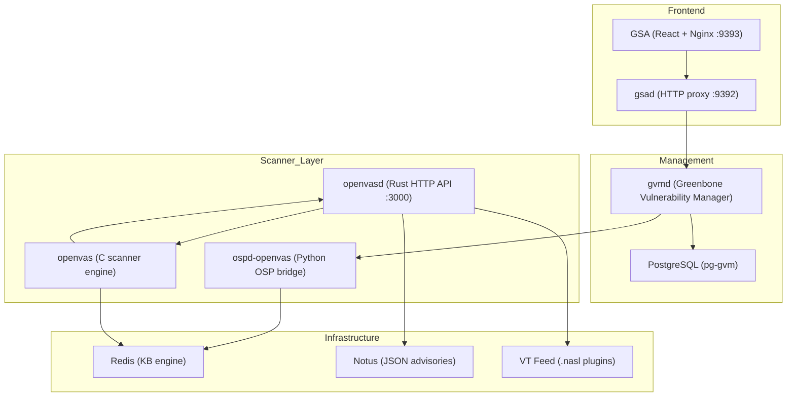

# Глубокий аудит сканера ak-shumkar-VM
**Дата:** 2026-03-16  
**Автор:** Senior Security Architect (AI-assisted analysis)  
**Версия:** 2.0 (дополненная)  
**Стек:** Greenbone Community Edition — OpenVAS / openvasd / Notus / GSA

---

## 1. Обзор архитектуры

Система сканирования состоит из **четырёх ключевых слоёв**:



### Docker-сервисы — полный стек (docker-compose.full.yml)

| Сервис | Образ | Роль |
|---|---|---|
| `vulnerability-tests` | `community/vulnerability-tests` | Загрузка NASL-плагинов (feed 24.10) |
| `notus-data` | `community/notus-data` | JSON-адвайзори Notus |
| `gpg-data` | `community/gpg-data` | GPG-ключи верификации фида |
| `scap-data` | `community/scap-data` | SCAP-данные (CVE/CPE) |
| `cert-bund-data` | `community/cert-bund-data` | CERT-Bund адвайзори |
| `dfn-cert-data` | `community/dfn-cert-data` | DFN-CERT адвайзори |
| `data-objects` | `community/data-objects` | Объекты gvmd (конфигурации, фильтры) |
| `report-formats` | `community/report-formats` | Шаблоны отчётов |
| `redis-server` | `community/redis-server` | Knowledge Base — IPC-шина |
| `pg-gvm` | `community/pg-gvm:stable` | PostgreSQL для gvmd |
| `configure-openvas` | `community/openvas-scanner:stable` | Генерация openvas.conf |
| `openvas` | `community/openvas-scanner:stable` | Лог-вьюер (tail -f) |
| `ospd-openvas` | `community/ospd-openvas:stable` | Python OSP-bridge → openvas |
| `openvasd` | `openvasd-local` (локальный build) | Rust REST API (:80), VT-кэш, Notus |
| `gvmd` | `community/gvmd:stable` | Менеджер задач, SCAP/CERT, PostgreSQL |
| `gsad` | `community/gsad:stable` | HTTP API proxy для GSA |
| `gsa` | `nginx:alpine` | Nginx → React SPA (:9393) |

**Volumes:** 14 docker volumes для данных, сокетов и логов.

---

## 2. Типы сканеров (GSA scanner.ts)

GSA поддерживает **8 типов сканеров**:

| Тип | Значение | Описание |
|---|---|---|
| OpenVAS Scanner | `2` | Классический C-сканер через ospd-openvas |
| CVE Scanner | `3` | Сканер на базе CPE/CVE сопоставления (без сетевых проб) |
| Greenbone Sensor | `5` | Удалённый сенсор (распределённое сканирование) |
| OpenVASD Scanner | `6` | Новый Rust-сканер (REST API) |
| Agent Controller | `7` | Управление агентами на хостах |
| OpenVASD Sensor | `8` | Удалённый OpenVASD сенсор |
| Agent Sensor | `9` | Удалённый агентный сенсор |
| Container Image Scanner | `10` | Сканер контейнерных образов |

> ⚠️ CVE Scanner и OpenVASD Scanner не клонируются и не редактируются через UI (hardcoded в `scanner.ts`).

---

## 3. Откуда берутся уязвимости? (3 источника)

### 3.1 NASL-плагины (Network Vulnerability Tests)

**Расположение:** `/var/lib/openvas/plugins/*.nasl`  
**Количество:** тысячи (Feed release 24.10)  
**Формат:** NASL (Nessus Attack Scripting Language)

**Загрузка при старте:**
```
pluginload.c → collect_nvts(folder) → рекурсивный обход директорий
→ для каждого .nasl: nasl_plugin_add() → парс + метаданные в Redis nvticache
→ ETA через shared memory (shmget/shmat)
→ останавливается при 20+ ошибках парсинга
```

**Встроенные NASL-функции (300+, из nasl_init.c):**

| Категория | Примеры функций |
|---|---|
| **Скриптовые** | `script_name`, `script_category`, `script_dependencies` |
| **KB** | `set_kb_item`, `get_kb_item`, `replace_kb_item` |
| **Сеть** | `open_sock_tcp`, `open_sock_udp`, `send`, `recv`, `recv_line` |
| **SSH** | `ssh_connect`, `ssh_login`, `ssh_request_exec`, `sftp_enabled_check` |
| **HTTP** | `http_get`, `http_post`, `http2_get`, `http2_put` |
| **SMB/WMI** | `smb_connect`, `smb_file_SDDL`, `wmi_connect`, `wmi_query` |
| **SNMP** | `snmpv1_get`, `snmpv2c_get`, `snmpv3_get` |
| **Крипто** | `MD5`, `SHA256`, `HMAC_SHA512`, `aes256_gcm_encrypt`, `RSA_sign` |
| **Пакеты** | `forge_ip_packet`, `forge_tcp_packet`, `forge_udp_packet`, `send_packet` |
| **TLS/Certs** | `cert_open`, `cert_query`, GNUTLS-функции |
| **Kerberos** | `okrb5_gss_init_context`, `okrb5_find_kdc` |
| **Сканнеры** | `plugin_run_synscan`, `plugin_run_openvas_tcp_scanner` |

**Встроенные порт-сканеры:**

1. **SYN Scanner** (`nasl_builtin_synscan.c`):
   - Отправляет raw SYN-пакеты через сырые сокеты
   - Использует BPF (Berkeley Packet Filter) для перехвата SYN-ACK
   - Поддерживает IPv4 и IPv6
   - Вычисляет RTT для адаптивного throttling
   - Обработка ретраев для неответивших портов
   - Требует `CAP_NET_RAW`

2. **TCP Connect Scanner** (`nasl_builtin_openvas_tcp_scanner.c`):
   - Connect-scan через `connect()`: надёжнее, но медленнее SYN
   - **`GRAB_MAX_SOCK_SAFE = 128`** — максимум параллельных TCP-соединений
   - **`MAX_PASS_NB = 16`** — максимум проходов через портовый диапазон
   - **`MAX_SANE_RTT = 2000000µs`** (2 секунд) — макс. разумный RTT
   - Включает **banner grab** — автоматически читает баннер сервиса
   - `double_check_std_ports()` — перепроверяет стандартные порты

3. **Find Service** (`nasl_builtin_find_service.c`, ~90KB):
   - Самый большой встроенный модуль
   - Идентификация сервисов по баннерам и поведению
   - Определяет протоколы: HTTP, FTP, SMTP, POP3, IMAP, SSH, SSL и т.д.

### 3.2 Notus (Table-Driven LSC — Local Security Checks)

**Расположение:** `/var/lib/notus/advisories/*.json`  
**Формат:** JSON-адвайзори по OS/пакетному менеджеру  
**Поддерживаемые форматы пакетов:** DEB, RPM, EBuild, Slack, Windows, ALPM (Arch)

**Механизм:**
```
SSH-плагин (GATHER_INFO) → ssh/login/release_notus + ssh/login/package_list_notus
    → Redis KB
        → call_lsc(args, ip_str) в attack.c
            → run_table_driven_lsc() в table_driven_lsc.c
                → HTTP POST openvasd:3000/notus (через libcurl)
                    → Notus::scan(os, packages) в Rust
                        → parse packages → compare with VTs → return vulnerable
```

**Каналы доставки:**
- `openvasd_server = http://openvasd:3000` — **основной** (curl → HTTP)
- `mqtt_server_uri` — **устаревший** (MQTT pub/sub)

**Нюансы в `table_driven_lsc.c`:**
- URL парсится через `curl_url()` (CURLU API)
- HTTPS → HTTP/2 (h2 ALPN), HTTP → HTTP/1.1
- `advisory_add_vuln_pkg()` — **жёсткий лимит 100 пакетов** на адвайзори
- Поддержка `fixed_version` в двух форматах: RANGE (start/end) и SINGLE (version/specifier)

### 3.3 Skiron (новый тип адвайзори)

Обнаружен второй тип адвайзори помимо Notus — **Skiron**:

```c
// table_driven_lsc.c
typedef enum { NOTUS, SKIRON } advisory_type;
```

Skiron-адвайзори содержат `oid` + `message` (вместо списка пакетов). Это указывает на более общий формат уведомлений безопасности, не привязанный к конкретным пакетам.

### 3.4 SCAP/CERT фиды (CVE Scanner)

```
scap-data → /var/lib/gvm/scap-data (CVE/CPE данные)
cert-bund-data → /var/lib/gvm/cert-data (CERT-Bund)
dfn-cert-data → /var/lib/gvm/cert-data (DFN-CERT)
```

CVE Scanner (тип `3`) использует эти данные для сопоставления CPE хоста с известными CVE — **без сетевых проб**, только на основе идентификации версий.

---

## 4. Как работает оркестр (детальная схема)

### 4.1 Путь запроса на сканирование

```
                        ┌── 1. Пользователь → GSA React (:9393)
                        │           │
                        │   2. HTTP POST /api → gsad (:9392)
                        │           │
                        │   3. GMP XML → gvmd (unix socket)
                        │           │
                        │   4. gvmd → создаёт задачу в PostgreSQL
                        │   5. gvmd → записывает prefs в Redis:
                        │      internal/<scan_id>/scanprefs
                        │           │
                        │   6. gvmd → ospd-openvas (unix socket, OSP XML)
                        │      ИЛИ → openvasd REST API (POST /scans)
                        │           │
                        │   7. ospd-openvas / openvasd → fork:
                        │      openvas --scan-start <scan_id>
                        │           │
                        ▼           ▼
```

### 4.2 Внутренний цикл openvas (C-процесс)

```c
// openvas.c → openvas() main entry
1. setproctitle / gcrypt_init / parse args
2. attack_network_init(globals, config_file)
   ├── set_default_openvas_prefs()
   ├── prefs_config(config_file) — чтение openvas.conf
   ├── plugins_cache_init() — init nvticache в Redis
   ├── Init Notus: openvasd_server ИЛИ mqtt_server_uri
   ├── init_signal_handlers() — SIGTERM, SIGINT, SIGCHLD
   └── overwrite_openvas_prefs_with_prefs_from_client()
       — чтение prefs из Redis KB
3. attack_network(globals) — основной цикл
```

### 4.3 Планировщик плагинов — 5 фаз

```
pluginscheduler.c → plugins_scheduler_next()
    ├── Phase 0: ACT_INIT (инициализация, единственная фаза)
    │   — cleanup → следующая фаза
    │
    ├── Phase 1: ACT_SCANNER (порт-сканирование)
    │   ⚠️ ОДНОПОТОЧНО: pluginlaunch_disable_parallel_checks()
    │   — SYN scan или TCP connect scan
    │   — cleanup → следующая фаза
    │
    ├── Phase 2: ACT_SETTINGS → ACT_GATHER_INFO
    │   — SSH-подключения, сбор банеров, пакетных списков
    │   — До max_checks=10 параллельно
    │   — cleanup → следующая фаза
    │
    ├── Phase 3: ACT_ATTACK → ACT_FLOOD
    │   — ACT_ATTACK: обычные проверки (до 10 параллельно)
    │   — ACT_MIXED_ATTACK: смешанные
    │   — ACT_DESTRUCTIVE_ATTACK: деструктивные (ТОЛЬКО если safe_checks=no)
    │   — ACT_DENIAL: DoS-проверки (ТОЛЬКО если safe_checks=no)
    │   — ACT_KILL_HOST: однопоточно!
    │   — ACT_FLOOD: однопоточно!
    │   — cleanup → следующая фаза
    │
    └── Phase 4: ACT_END
        — Завершающие проверки
        — cleanup → NULL (конец)
```

**Все 11 категорий NVT** (`nvt_categories.h`):
```
ACT_INIT = 0
ACT_SCANNER = 1
ACT_SETTINGS = 2
ACT_GATHER_INFO = 3
ACT_ATTACK = 4
ACT_MIXED_ATTACK = 5
ACT_DESTRUCTIVE_ATTACK = 6
ACT_DENIAL = 7
ACT_KILL_HOST = 8
ACT_FLOOD = 9
ACT_END = 10
```

### 4.4 Управление процессами плагинов

```c
// pluginlaunch.c
#define MAX_PROCESSES 32  // жёсткий лимит

struct running processes[MAX_PROCESSES];
// Каждый элемент: pid, plugin pointer, start time, timeout

plugin_launch() → 
    pluginlaunch_wait_for_free_process()  // ждём свободный слот
    next_free_process()                    // проверяем non_simult_ports
    nasl_plugin_launch()                   // fork() + exec NASL
    
update_running_processes() →
    - проверяет is_alive(pid)
    - проверяет timeout
    - убивает группу процессов при timeout: kill(-PID, ...)
    - heartbeat: check_host_still_alive() при max_nvt_timeouts
```

### 4.5 IPC: openvas → parent process

```c
// ipc_openvas.c
enum ipc_data_type {
    IPC_DT_NO_DATA,
    IPC_DT_ERROR,
    IPC_DT_HOSTNAME,     // обнаруженные vhosts
    IPC_DT_USER_AGENT,   // обнаруженный User-Agent
    IPC_DT_LSC           // ready to run LSC
};
```

Дочерние NASL-процессы общаются с родительским через pipe JSON-сообщения. Родитель в `read_ipc()` обрабатывает: добавление vhosts, обновление User-Agent, сигнал готовности LSC.

### 4.6 Rust ScanRunner (openvasd)

```rust
// scan_runner.rs
pub struct ScanRunner<S> {
    scan: &Scan,
    storage: &S,
    loader: &Loader,
    executor: &Executor,
    concurrent_vts: Vec<ConcurrentVT>,
}

// Исполнение VT строго последовательное через stream::unfold:
// host[0] → stage[0] → vt[0]
// host[0] → stage[0] → vt[1]
// ...
// host[0] → stage[1] → vt[0]
// ...
// host[1] → stage[0] → vt[0]
```

> ⚠️ **КРИТИЧНО**: Комментарий в коде: *"The usage of unfold here will prevent any real asynchronous running of VTs and automatically guarantee that we stick to the scheduling requirements."* — VT запускаются **строго последовательно** по одному.

### 4.7 VTRunner: выполнение одного VT

```rust
// vt_runner.rs
VTRunner::run() →
    1. check_keys() — проверка required_keys, mandatory_keys, excluded_keys, required_ports
    2. Code::load(loader, filename) — загрузка NASL из файла
    3. ForkingInterpreter::new(ast, register, context).stream()
    4. Обработка результатов: Exit(code), Error(e), Ok(value)
```

---

## 5. Почему сканирования идут так долго? (12 причин)

### 5.1 Последовательность фаз (фундаментальная причина)

Планировщик строго фазовый: фаза N+1 начинается **только после полного завершения** фазы N. При этом `ACT_SCANNER`, `ACT_KILL_HOST`, `ACT_FLOOD` — **всегда однопоточные**.

### 5.2 Rust ScanRunner — последовательный unfold

В openvasd VT запускаются строго последовательно через `stream::unfold` — **один VT за раз**. Это гарантирует соблюдение зависимостей, но убивает параллелизм.

### 5.3 max_checks=10 при тысячах VT

```
5000 VT / 10 параллельных = 500 батчей ожидания
При avg 1-3 сек/VT = 500-1500 секунд (8-25 минут) на один хост
```

### 5.4 TCP Connect Scanner — 128 сокетов max

```c
#define GRAB_MAX_SOCK_SAFE 128     // максимум параллельных connect()
#define MAX_PASS_NB 16              // максимум проходов по портам
#define MAX_SANE_RTT 2000000        // 2 секунды макс RTT
```

Для полного TCP-скана (65535 портов):
```
65535 / 128 ≈ 512 раундов × ~2 секунды = ~17 минут
```

### 5.5 SYN Scanner и ретраи

SYN-скан быстрее, но `rm_dead_packets()` делает ретраи для неответивших портов. При firewall DROP — каждый порт ждёт полного RTT таймаута.

### 5.6 Plugin таймауты

Каждый зависший плагин ждёт полного таймаута (NVT_TIMEOUT / SCANNER_NVT_TIMEOUT) перед убийством. При firewall DROP → десятки-сотни секунд per plugin.

### 5.7 non_simult_ports — последовательное ожидание

Плагины, требующие одного порта, ждут друг друга с `usleep(250000)` (250ms polling):
```c
while (process_alive(processes[r].pid)) {
    update_running_processes(main_kb, kb);
    usleep(250000);  // 4 проверки в секунду
}
```

### 5.8 Главный цикл attack_host — 50ms polling

```c
else if (plugin == PLUG_RUNNING)
    usleep(50000);  // 50ms busy-wait
```

### 5.9 VT-кэш — холодный старт

При пустом Redis nvticache: парсинг тысяч .nasl файлов → 5-30 минут. Прогресс выводится каждые 50 файлов через shared memory.

### 5.10 Boreas alive detection

Перед сканированием хосты проверяются через Boreas (ARP/ICMP/TCP). Для больших подсетей — минуты на alive detection.

### 5.11 SSH-подключения для LSC

Каждый хост требует SSH-соединения для сбора пакетов. TAT (turn-around-time) зависит от сети и нагрузки SSH-сервера.

### 5.12 advisory_add_vuln_pkg — лимит 100 пакетов/адвайзори

```c
if (adv->count == 100) {
    g_warning("Failed adding new vulnerable package... No more free slots");
    return;
}
```

Если адвайзори содержит > 100 уязвимых пакетов, остальные молча отбрасываются.

---

## 6. Потенциальные уязвимости и проблемы (расширенный)

### 6.1 Redis без аутентификации (CRITICAL)

Redis доступен через unix socket без пароля. Любой процесс с доступом к `redis_socket_vol` может:
- Читать SSH-пароли из `internal/<scan_id>/scanprefs`
- Модифицировать результаты сканирования
- Инжектировать ложные результаты через `internal/results`

### 6.2 openvasd — `privileged: true` (CRITICAL)

В `compose/base.yaml`:
```yaml
openvasd:
  privileged: true  # для setcap cap_net_raw,cap_net_admin
```
Замена:
```yaml
cap_add:
  - NET_RAW
  - NET_ADMIN
security_opt:
  - seccomp=unconfined  # если нужно для raw sockets
```

### 6.3 ospd-openvas — `seccomp=unconfined + apparmor=unconfined` (HIGH)

```yaml
ospd-openvas:
  security_opt:
    - seccomp=unconfined
    - apparmor=unconfined
```
Полностью отключена изоляция ядра. При компрометации NASL-плагина — полный побег из контейнера.

### 6.4 HTTP (не HTTPS) для LSC-данных (HIGH)

```
openvasd_server = http://openvasd:3000   # в base.yaml
openvasd_server = http://openvasd:80     # в full.yml
```
Пакетные списки хостов и результаты Notus передаются в открытом виде по Docker-сети.

### 6.5 Bug: `connect_main_kb()` — проверка указателя вместо значения (MEDIUM)

```c
static int connect_main_kb(kb_t *main_kb) {
    *main_kb = kb_direct_conn(...);
    if (main_kb)   // ← ВСЕГДА true (проверяет адрес параметра)
        return 0;
    // Ошибки подключения к Redis скрыты!
}
```

### 6.6 Shared memory для прогресса загрузки — race condition (MEDIUM)

```c
loading_shmid = shmget(rand() + 1, sizeof(int) * 2, IPC_CREAT | 0600);
```
- `rand()` без seed → предсказуемый ключ
- Нет блокировки при доступе к `loading_shm[0]` и `loading_shm[1]`
- Другой процесс может подключиться к SHM-сегменту

### 6.7 NASL `exec_nasl_script` — потенциал RCE через плагины (MEDIUM)

NASL поддерживает вызов системных команд (`nasl_cmd_exec.c`). Если VT-фид скомпрометирован (подмена .nasl файлов), злоумышленник получает RCE на сканирующей машине.

**Защита:** GPG-подпись фида, но `signature_check` может быть отключена.

### 6.8 Hardcoded MAX_PROCESSES=32 (LOW)

Не масштабируется. При необходимости больше 32 параллельных плагинов — требуется перекомпиляция.

### 6.9 gsad — `--http-only` в docker-compose.full.yml (LOW)

```yaml
GSAD_ARGS: --listen=0.0.0.0 --http-only --api-only -v -f
```
GSA API слушает на HTTP без TLS. Любой в Docker-сети видит GMP-трафик.

---

## 7. Полная карта потоков данных

```
┌─────────────────── FEED SOURCES (Docker Init Containers) ──────────────────┐
│                                                                             │
│  vulnerability-tests → vt_data_vol (/var/lib/openvas/plugins/*.nasl)        │
│  notus-data          → notus_data_vol (/var/lib/notus/advisories/*.json)    │
│  gpg-data            → gpg_data_vol (/etc/openvas/gnupg/)                  │
│  scap-data           → scap_data_vol (/var/lib/gvm/scap-data/)             │
│  cert-bund-data      → cert_data_vol (/var/lib/gvm/cert-data/)             │
│  dfn-cert-data       → cert_data_vol                                       │
│  data-objects        → data_objects_vol                                     │
│  report-formats      → data_objects_vol                                    │
└─────────────────────────────────────────────────────────────────────────────┘
                                    │
                    ┌───────────────┼────────────────┐
                    ▼               ▼                ▼
            ┌──────────────┐  ┌──────────┐  ┌──────────────┐
            │   openvasd   │  │   gvmd   │  │ ospd-openvas │
            │  (Rust :3000)│  │(Manager) │  │   (Python)   │
            └──────┬───────┘  └────┬─────┘  └──────┬───────┘
                   │               │               │
                   │  ┌────────────┤               │
                   │  │            │               │
                   │  │    ┌───────▼───────┐       │
                   │  │    │  PostgreSQL   │       │
                   │  │    │   (pg-gvm)    │       │
                   │  │    └───────────────┘       │
                   │  │                            │
            ┌──────▼──▼────────────────────────────▼───────┐
            │              Redis (KB Engine)                │
            │  ┌─ internal/<scan_id>/scanprefs             │
            │  ├─ internal/<scan_id> = ready/finished      │
            │  ├─ internal/results (результаты)            │
            │  ├─ internal/status (прогресс)               │
            │  ├─ internal/dbindex (хосты)                 │
            │  ├─ nvticache (OID → метаданные VT)          │
            │  ├─ Host/dead (хост мёртв)                   │
            │  ├─ ssh/login/release_notus                  │
            │  └─ ssh/login/package_list_notus             │
            └──────────────┬───────────────────────────────┘
                           │
                    ┌──────▼──────┐
                    │   openvas   │
                    │  (C engine) │
                    │  fork()     │──→ NASL plugin [pid]
                    │  fork()     │──→ NASL plugin [pid]
                    │  ...        │──→ ... (max 10-32)
                    └─────────────┘
```

---

## 8. Heartbeat и Alive Detection

### Boreas (alive detection перед сканированием)

```c
// heartbeat.c → check_host_still_alive()
// Вызывается при max_nvt_timeouts для проверки: жив ли хост?
// Использует boreas: is_host_alive(hostname, &is_alive)
// Методы: ALIVE_TEST_TCP_ACK_SERVICE, ICMP, ARP
// При dead: kb_item_set_int(kb, "Host/dead", 1)
```

**Alive test методы** (комбинируются как bitfield):
- TCP ACK service
- ICMP ping
- ARP ping
- Consider Alive (всегда считать живым)

### max_nvt_timeouts → Host dead

Если слишком много VT таймаутятся → heartbeat проверяет хост → если мёртв → `Host/dead=1` → все оставшиеся VT пропускаются.

---

## 9. Рекомендации

### 9.1 Производительность

| Параметр | Текущее | Рекомендация |
|---|---|---|
| `max_hosts` | 15 | 5-8 на слабом железе, 20+ на мощном |
| `max_checks` | 10 | 15-20 при RAM > 8GB |
| `plugins_timeout` | cmake default | Явно 180-300s |
| `scanner_plugins_timeout` | cmake default | Явно 60s |
| `max_vts_timeouts` | не задан | Установить 10-20 (early host dead detection) |
| VT-набор | full | Ограниченный scan config (только нужные семейства) |
| Alive detection | для всей подсети | Точный CIDR, avoid /8-/16 |
| `OPENVAS_LOG_LEVEL` | 64 (INFO) | 16 (WARNING) в production |

### 9.2 Безопасность

| Проблема | Приоритет | Решение |
|---|---|---|
| Redis без auth | CRITICAL | `requirepass` + ограничить socket permissions |
| `privileged: true` | CRITICAL | `cap_add: [NET_RAW, NET_ADMIN]` |
| `seccomp=unconfined` | HIGH | Создать минимальный seccomp-профиль |
| HTTP для LSC | HIGH | HTTPS с self-signed cert |
| `connect_main_kb` bug | MEDIUM | `if (*main_kb)` вместо `if (main_kb)` |
| GPG signature bypass | MEDIUM | Enforce `signature_check = true` |
| gsad `--http-only` | LOW | TLS termination на nginx |

### 9.3 Архитектурные

- **Rust ScanRunner**: рассмотреть асинхронный параллелизм VT (сейчас — строго `unfold`)
- **MAX_PROCESSES=32**: сделать конфигурируемым через env/config
- **advisory_add_vuln_pkg limit=100**: увеличить или сделать динамическим
- **SHM для прогресса**: заменить на pipe/socket или атомарные операции

---

## 10. Выводы

1. **3 источника уязвимостей**: NASL VTs (сетевые проверки), Notus/Skiron (пакетные LSC), SCAP/CERT (CVE-сопоставление)
2. **8 типов сканеров**: от классического OpenVAS до Container Image Scanner и Agent Controller
3. **Оркестратор**: gvmd → ospd-openvas/openvasd → openvas (fork per scan) → NASL plugins (fork per VT)
4. **Планировщик**: строго 5-фазовый, причём ACT_SCANNER, KILL_HOST, FLOOD — всегда однопоточные
5. **Rust ScanRunner**: VT выполняются последовательно через `stream::unfold`
6. **12 причин медленного сканирования**: от архитектуры (фазовый планировщик, 128-socket limit) до инфраструктуры (Redis как IPC, VT-кэш cold start)
7. **9 security-проблем**: от критических (Redis no-auth, privileged mode) до архитектурных (SHM race condition, hardcoded limits)
